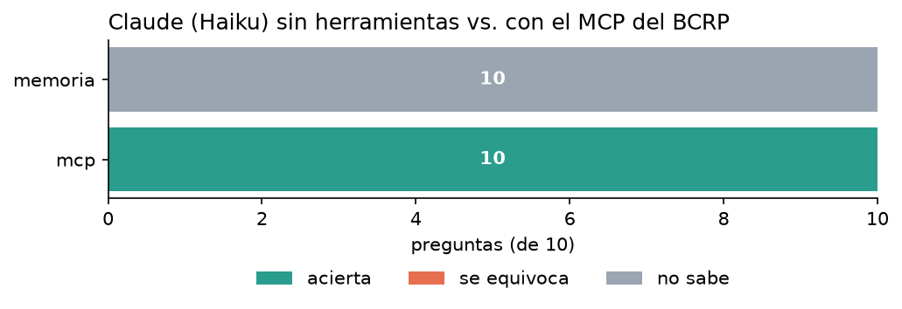
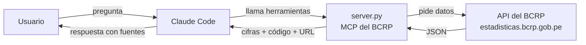

# MCP del BCRP · cifras oficiales del Perú para Claude

Un servidor [MCP](https://modelcontextprotocol.io) que conecta a Claude con las **17,167 series estadísticas del
Banco Central de Reserva del Perú**: inflación, tipo de cambio, tasas de interés, reservas, PBI, precios de metales y
petróleo, crédito, exportaciones y más.

Con él, Claude deja de responder cifras de memoria y las consulta en la fuente oficial. Cada número viene con el
código de la serie, el periodo y la URL del BCRP, y las cuentas (variaciones, promedios, correlaciones) las hace
Python, no el modelo.



En una prueba con 10 preguntas sobre cifras recientes, Claude Haiku **acertó 10 de 10 con el MCP** y ninguna sin él.
Sin el MCP respondió «no sé» o, si no se le dejaba esa salida, inventó cifras. Detalles en [informe.md](informe.md).

---

## ¿Qué es un MCP?

El *Model Context Protocol* es un estándar para darle a un asistente de IA acceso a herramientas y datos externos.
Un servidor MCP ofrece tres tipos de piezas:

| Pieza | Quién la activa | Para qué |
|---|---|---|
| **Herramientas** | El modelo, cuando la pregunta lo requiere | Ejecutar algo: buscar, descargar, calcular |
| **Recursos** | El usuario, con `@` | Adjuntar información de contexto a la conversación |
| **Prompts** | El usuario, con `/` | Lanzar una tarea completa ya redactada |



## Qué ofrece este servidor

### Herramientas

| Herramienta | Qué hace |
|---|---|
| `buscar_series` | Busca en el catálogo del BCRP por palabras clave y, si se quiere, por frecuencia (diaria, mensual, trimestral, anual). Devuelve el código de cada serie, su nombre, su frecuencia y desde cuándo hay datos |
| `serie` | Descarga los datos de una serie entre dos fechas, con la URL de la fuente |
| `resumen` | Calcula primer y último valor, cambio, variación %, promedio, máximo y mínimo (con su periodo) |
| `comparar_series` | Alinea dos o más series de la misma frecuencia por periodo y da la variación % de cada una y la correlación entre cada par, en niveles y en cambios de un periodo al siguiente |

### Recursos

| Recurso | Contenido |
|---|---|
| `bcrp://serie/{codigo}` | Ficha de cualquier serie: nombre, categoría, frecuencia, inicio, última actualización y link a su página web |
| `bcrp://energia` | Códigos de las series de petróleo WTI, tipo de cambio interbancario e inflación, con una guía de cuáles combinar |

### Prompts

| Prompt | Argumentos | Qué hace |
|---|---|---|
| `informe` | `tema` | Redacta un informe sobre un tema económico del Perú citando código y periodo de cada cifra |
| `choque_petroleo` | `desde`, `hasta` | Analiza si el petróleo, el tipo de cambio y la inflación se movieron juntos en ese rango |

Las fechas siguen un solo formato: `2025-01` (mensual), `2025-01-15` (diaria), `2025-T1` (trimestral) o `2025` (anual).

---

## Instalación

Requisitos: [uv](https://docs.astral.sh/uv/), [Claude Code](https://claude.com/claude-code) con sesión iniciada e
internet. No hace falta ninguna clave: la API del BCRP es pública.

```bash
git clone https://github.com/av-gomez/mcp-bcrp.git
cd mcp-bcrp
uv run pytest -q          # instala dependencias y comprueba que todo funciona: 8 passed
```

La primera ejecución baja el catálogo del BCRP (unos 7 MB) a la carpeta `datos/`.

## Uso con Claude Code

El archivo [`.mcp.json`](.mcp.json) ya registra dos servidores para esta carpeta: `bcrp` (este proyecto) y `fetch`
(lee páginas web). Basta con abrir Claude Code aquí:

```bash
claude
```

1. La primera vez, Claude Code pregunta si apruebas los servidores de `.mcp.json`: acepta.
2. Escribe `/mcp` para confirmar que están conectados.
3. Pregunta en lenguaje natural sobre cualquier indicador del BCRP. Claude busca la serie y la consulta solo.
4. Para adjuntar un recurso, escribe `@bcrp:` seguido de su dirección.
5. Para lanzar un prompt, escribe `/mcp__bcrp__` seguido de su nombre y sus argumentos.

Los servidores solo están disponibles cuando abres Claude Code dentro de esta carpeta. Para tenerlos en cualquier
carpeta, regístralos para tu usuario con la ruta completa del proyecto:

```bash
claude mcp add --scope user bcrp -- uv run --directory /ruta/a/mcp-bcrp server.py
```

## Uso desde Python

El servidor también se puede llamar sin Claude, con el cliente de FastMCP:

```python
import asyncio
from fastmcp import Client
from server import mcp

async def main():
    async with Client(mcp) as c:
        r = await c.call_tool("resumen", {"codigo": "PN01273PM", "desde": "2025-12", "hasta": "2026-09"})
        print(r.data)

asyncio.run(main())
```

---

## Cómo funciona por dentro

- **Catálogo:** el BCRP publica la lista de todas sus series; se baja una vez y se busca en ella sin tildes ni
  mayúsculas, priorizando las series vigentes y de nombre más general.
- **Fechas:** la API escribe los periodos de varias formas (`Ene.2025`, `01.Oct.26`, `T1.25`, y setiembre como `Sep`
  o `Set`). El servidor las convierte todas a un formato ISO único y salta los valores `n.d.`.
- **Límite de pedidos:** cuando la API recibe muchos pedidos seguidos responde una página HTML en vez de datos. El
  servidor espera y reintenta hasta cinco veces.
- **Caché:** cada descarga se guarda un día en `datos/api/`, así las preguntas repetidas no vuelven a llamar al BCRP.
- **Errores claros:** un código inexistente, frecuencias distintas o un rango sin datos devuelven un mensaje que
  explica qué corregir.

## Evaluación: ¿inventa cifras Claude?

[`evaluar.py`](evaluar.py) le hace a Claude cada pregunta de [`preguntas.csv`](preguntas.csv) sin herramientas
(«memoria») y con este MCP, y compara la respuesta con la cifra oficial dentro de una tolerancia.

```bash
uv run evaluar.py                                # memoria contra mcp, con Haiku
uv run evaluar.py --modos memoria web mcp        # agrega búsqueda web
uv run evaluar.py --modelo sonnet --paralelo 2   # otro modelo, menos pedidos simultáneos
```

En Windows, antepón `PYTHONUTF8=1` (o en PowerShell, `$env:PYTHONUTF8=1;`) para que lea bien los acentos.

| Modo | Acierta | Se equivoca | No sabe | Segundos promedio |
|---|---:|---:|---:|---:|
| memoria | 0 | 0 | 10 | 7.0 |
| mcp | 10 | 0 | 0 | 14.7 |

El análisis completo, incluido un experimento en el que Claude inventa una cifra cuando no se le permite decir
«no sé», está en [informe.md](informe.md).

## Estructura del proyecto

```
mcp-bcrp/
├── server.py              El servidor MCP
├── test_server.py         Pruebas con datos reales del BCRP
├── evaluar.py             Evaluación: Claude con y sin el MCP
├── preguntas.csv          Preguntas de la evaluación con su cifra oficial y tolerancia
├── resultados.csv         Resultados de la última evaluación
├── informe.md             Análisis de la evaluación
├── grafico.png            Aciertos por modo
├── .mcp.json              Servidores MCP del proyecto (bcrp y fetch)
├── pyproject.toml         Dependencias (uv)
├── scripts/
│   ├── verificar.py       Prueba el servidor tal como lo lanza Claude Code
│   └── grafico.py         Genera grafico.png desde resultados.csv
├── docs/
│   ├── verdades.md        De dónde salió cada cifra oficial nueva
│   ├── consigna.md        Enunciado original del proyecto
│   └── experimento/       Corridas de la evaluación con y sin la opción «no sé»
└── datos/                 Catálogo y caché (se genera solo; no está en git)
```

## Créditos

Los datos son del [BCRP](https://estadisticas.bcrp.gob.pe). El proyecto parte de la sesión
[04-mcp-claude-code](https://github.com/d2cml-ai/Data-Science-Python) del curso de Data Science con Python de
d2cml-ai, y usa [FastMCP](https://gofastmcp.com).
